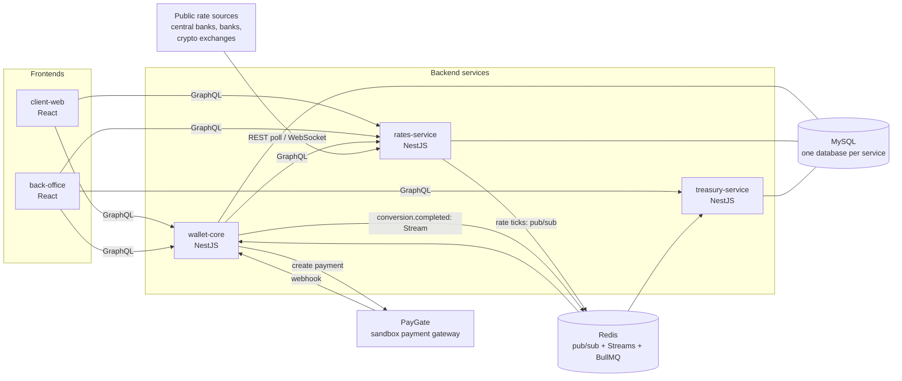

# Architecture

## Big picture

In words: the two frontends talk to the backend services over **GraphQL**. `rates-service` pulls rates from public
sources and publishes live ticks. `wallet-core` owns users, money and client settings, and talks to PayGate for
card top-ups. `treasury-service` listens to completed conversions and hedges the resulting exposure.

## Repositories

| Repo | What it is | Main responsibilities |
|---|---|---|
| `wallet-core` | NestJS service | Auth & JWT, users, staff & permissions, client settings, customization module, KYC (manual), ledger & balances, conversions & quotes, transfers, withdrawals, top-ups via PayGate, audit log |
| `rates-service` | NestJS service | Source adapters (polling + WebSocket), aggregation (staleness, outliers, consensus, triangulation), live rate stream, source monitor |
| `treasury-service` | NestJS service, gateway + worker processes | Exposure per currency, threshold hedging worker (paper execution), hedge history, P&L |
| `client-web` | React app | End-user wallet |
| `back-office` | React app | Staff & platform admin UI |
| `ops` | Infrastructure | Shared CI/CD workflows, release automation, docker-compose for the whole system, list of clients and environments |
| `paygate` | **External** sandbox provider | Fake card payment gateway. Maintained by the mentor — treat it exactly like a real third-party API: you only use its public API and docs |

You get **skeleton repositories** (empty NestJS / React apps with tooling configured). The features are yours to build.

## Tech stack

| Area | Choice |
|---|---|
| Language | TypeScript everywhere |
| Backend framework | **NestJS** + **GraphQL** (Apollo) |
| Database | **MySQL**, one database per service |
| DB access | **Knex** (query builder + migrations) |
| Background jobs | **BullMQ** (on Redis) |
| Events | **Redis** pub/sub and Redis Streams |
| Frontend | **React** + **Redux Toolkit** + **MUI** (incl. DataGrid) |
| Frontend GraphQL | `graphql-request` (queries/mutations), `graphql-ws` (subscriptions), types generated with graphql-codegen |
| Frontend build | **Vite** |
| Tests | **Jest** (backend), **Vitest** + **Playwright** (frontend) |
| CI/CD | GitHub Actions → container images → deploy per environment |

Both frontends use the same stack, so you can move between them easily.

## How services communicate

| Kind | Mechanism | Use for | Example |
|---|---|---|---|
| Frontend → backend | GraphQL queries & mutations | Everything the UI reads or changes | `balances`, `createQuote`, `confirmConversion` |
| Frontend ← backend, live | GraphQL subscriptions (WebSocket) | Live data | `rateUpdated`, balance changes, exposure |
| Service → service, sync | GraphQL | Asking another service now, needing an answer (rare) | `wallet-core` loads the current rates from `rates-service` once on start |
| Service → service, live data | **Redis pub/sub** | Fire-and-forget; missing one message is fine | `rate.tick`: `wallet-core` and `treasury-service` keep the latest rates in memory from it, so conversions keep working if `rates-service` restarts |
| Service → service, events | **Redis Streams** + consumer groups | Events that must **not** be lost; consumers ack and retry | `conversion.completed` → `treasury-service` |

Rules of thumb:

- If losing the message would lose money or break reporting → **Stream**, not pub/sub.
- Consumers must be **idempotent**: the same event may arrive twice.
- Event payloads are contracts: they are typed, versioned with care, and reviewed by consumers.

## Authentication & authorization

- `wallet-core` is the only service that **issues JWTs** (access + refresh) for users and staff.
- Other services **verify the signature** with the public key — they never call `wallet-core` to check a token.
- Login methods: email + password; Sign in with Google for users who have linked their Google account (can be disabled per client).
- Staff actions are protected by **permission strings**, e.g. `bo:users` (view) and `bo:users:modify` (change).
  The back-office hides pages and buttons the staff member has no permission for; the backend enforces it regardless.
- Until real auth exists, the skeletons provide a **dev mode** so you can build business logic without real tokens
  (see [workflow.md](workflow.md#working-in-parallel)).

## Rate limits

Every backend (`wallet-core`, `rates-service`, `treasury-service`) has the same global rate limit, so one user or one
IP cannot overload a service. It is a global guard in each service's `src/throttling`; details are in each repo's
README, section "Rate limits".

| Caller | Counted per | Default limit per 60 s |
|---|---|---|
| Not logged in | client IP (`X-Forwarded-For`, one trusted proxy: Traefik) | 120 |
| Logged-in user / staff | user id / staff id from the token | 600 |

- **One HTTP request counts once**, however many fields a GraphQL request has.
- **Fixed window.** Once the limit is hit, requests are refused until the window ends.
- **Each service counts on its own.** Counters live in the shared Redis under
  `<APP_ENV>:throttle:<service>:<key>`, e.g. `staging:throttle:wallet-core:user:42`.
- **Refused request:** GraphQL error `TOO_MANY_REQUESTS` with `extensions.retryAfterSeconds`; REST `429` with
  `Retry-After`. Both give the seconds until the window ends — the frontend waits that long before retrying.
- **Not counted:** `GET /health`, `/metrics` (wallet-core) and everything over the WebSocket (subscriptions).
- **Redis down:** requests pass without a limit and a warning is logged at most once a minute.
- **Changing a limit** on an environment: `THROTTLE_TTL_SECONDS`, `THROTTLE_LIMIT_ANONYMOUS`, `THROTTLE_LIMIT_USER`,
  set by the mentor (see [workflow.md](workflow.md#environment-variables)).

## Redis outages

A backend needs MySQL to work, but not Redis. While Redis is down, only the features that use Redis stop.

- **Start and reconnect.** All three backends start without Redis and reconnect automatically when it is back.
  You do not need to restart them.
- **Health.** If only Redis is down, `GET /health` returns HTTP 200 with `status: "degraded"` and `redis: "DOWN"`, so
  health checks can treat the service as available. If the database is down, it returns HTTP 503. When both are up,
  `status` is `"ok"`.
- **Requests.** A request that needs Redis fails on its own (e.g. `POST /diagnostics/ping` returns 503). Requests that
  do not depend on unavailable Redis functionality can continue. The rate limit fails open: requests pass without a
  limit (see [Rate limits](#rate-limits)).
- **Connections.** The shared command client has no offline queue and a 2-second command timeout, so a command fails
  quickly instead of waiting for Redis. The pub/sub subscriber keeps its queue and resubscribes automatically after
  reconnecting.
- **Lost and repeated messages.** Pub/sub messages sent while a service is disconnected are not replayed. A command
  that was in flight may be sent again after reconnecting, so a timeout does not prove the command was not delivered.
- **wallet-core emails.** Enqueueing an email waits at most 5 s. If it times out, the job may still be stored and sent
  later, so delivery is uncertain. On shutdown, the email worker gives running sends 3 s to finish and then closes by
  force. Closing by force does not cancel a send that is still running. The job may run again, so SMTP may deliver a
  duplicate.
- **treasury-service jobs.** Scheduling the heartbeat job does not block startup. On shutdown, the service closes the
  Worker and the Queue connections it owns. Future long-running processors (e.g. hedging) need their own shutdown
  policy.
- **Deploys.** The CI deploy gate accepts HTTP 200 from `/health` with the expected SHA as `version` and `status`
  `ok` or `degraded`. A `degraded` deploy passes with a warning. The gate skips the SHA check only when the caller sets
  `check-version: false`.
- **Stream consumers** (e.g. `conversion.completed` → `treasury-service`) are a separate task. This section does not
  describe their behavior yet.

Details are in each backend's README (*Events*, *Rate limits*; wallet-core *Email*; treasury-service *Process roles*)
and in the `ops` README (*Deployment*). To try the behavior locally, see
[setup.md](setup.md#redis-outage-demo-local).

## External rate sources

All sources are **free public APIs** that work without an API key. Check each source's terms of use
(rate limits, attribution, caching) before relying on it.

| Source | Type | Speed | Good for learning |
|---|---|---|---|
| National Bank of Ukraine (NBU) | REST poll | Daily official rate | UAH reference rate, business days |
| PrivatBank | REST poll | Intraday | Buy/sell rates |
| Monobank | REST poll | Intraday, strict rate limit | Caching, respecting rate limits |
| Frankfurter (ECB data) | REST poll | Daily, working days | EUR-based rates, weekend gaps |
| National Bank of Poland (NBP) | REST poll | Daily, working days | PLN reference rate |
| ExchangeRate-API (open access) | REST poll | Daily | Attribution requirement |
| Kraken | WebSocket stream | Real-time, 24/7 | Reconnects, heartbeats, silent-feed detection |
| Binance | WebSocket stream | Real-time | Triangulation via USDT |
| Coinbase Exchange | WebSocket stream | Real-time | Another stablecoin/fiat source |

Mixing slow official sources with real-time exchange feeds is deliberate: it creates real aggregation problems —
different update speeds, bid/ask vs. mid, staleness per source, outliers.

## Environments

Each environment serves **exactly one client**, chosen by the `CLIENT` environment variable, and has its own databases.
There is no client production environment — UAT is the final stage in this project.

| Environment | Deployed from branch | `CLIENT` | Dev auth | Client app | Back-office |
|---|---|---|---|---|---|
| `staging` | `main` | `demo` | on | <https://staging.wallet.shatori.com> | <https://staging-admin.wallet.shatori.com> |
| `kvitka-uat` | `client/kvitka-uat` | `kvitka` | off | <https://kvitka-uat.wallet.shatori.com> | <https://kvitka-uat-admin.wallet.shatori.com> |
| `wisla-uat` | `client/wisla-uat` | `wisla` | off | <https://wisla-uat.wallet.shatori.com> | <https://wisla-uat-admin.wallet.shatori.com> |
| `stablo-uat` *(later)* | `client/stablo-uat` | `stablo` | off | `https://stablo-uat.wallet.shatori.com` | `https://stablo-uat-admin.wallet.shatori.com` |

Backends of an environment (GraphQL at `/graphql`, health at `/health`, subscriptions over `wss://` on the same path):

| Service | URL |
|---|---|
| `wallet-core` | `https://<env>-wallet-core.wallet.shatori.com` (e.g. <https://staging-wallet-core.wallet.shatori.com/health>) |
| `rates-service` | `https://<env>-rates.wallet.shatori.com` |
| `treasury-service` | `https://<env>-treasury.wallet.shatori.com` |

- Frontends are static builds on **Cloudflare Pages**; backends run on the mentor's VPS (Dokploy) with one shared
  MySQL (a database per environment and service, e.g. `staging_wallet_core`) and one Redis (keys prefixed with `APP_ENV`).
- Logs of all deployed backends go to Grafana Loki: <https://logs.wallet.shatori.com> — see [logging.md](logging.md).
- PayGate is **one shared instance**: <https://paygate.wallet.shatori.com> (docs at [`/docs`](https://paygate.wallet.shatori.com/docs)).
- Deploys happen **only through CI**: a push (a merged PR) to `main` or `client/<c>-uat` builds the image / static app in
  GitHub Actions and redeploys that environment; the job turns green only when the new version is live.
  Nobody deploys by hand. See [workflow.md](workflow.md#branches-and-releases) and the `ops` README (*Deployment*).
- Locally, you run the whole system with docker-compose — see [setup.md](setup.md).
